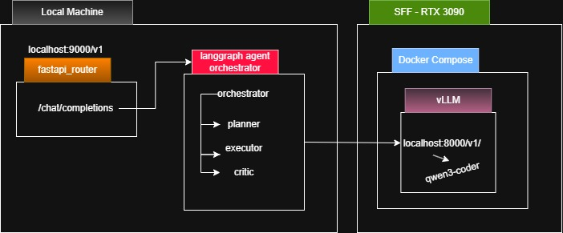

<h1>Medusa</h1>

Welcome to Medusa. A multi agent workflow. Implemented using langgraph for agent orchestration and vLLM running an instance of qwen3-coder30B for inference.

<h2>Setup</h2>



From the root directory, run 
```
docker compose up
```
This will spin up vLLM, hosted at http://vllm:8000

Then run
```
  python3 -m venv .venv
  source .venv/bin/activate

  pip install fastapi uvicorn httpx langchain-openai langgraph langchain
  
  uvicorn gateway.fastapi_router:app --host 0.0.0.0 --port 9000
```

Here is an example curl
```
curl http://localhost:9000/v1/chat/completions \
  -H "Content-Type: application/json" \
  -d '{
    "model":"qwen3-coder",
    "messages":[{"role":"user","content":"write a hello world in go"}]
  }'
```

<h2>Voice Assistant Client (WSL)</h2>

To have a real-time full-duplex voice conversation with Medusa in WSL:

```bash
# 1. Install voice client dependencies
pip install -r requirements-voice.txt

# 2. Launch the interactive voice client (Push-to-Talk)
python3 voice_client.py
```

Voice Client Options:
- `python3 voice_client.py`: Interactive push-to-talk conversation.
- `python3 voice_client.py --voice jarvis`: Change TTS voice.
- `python3 voice_client.py --duration 5`: Record fixed 5-second bursts instead of push-to-talk.
- `python3 voice_client.py --text "Hello Medusa"`: Send text and hear voice response.
- `python3 voice_client.py --input-file sample.wav`: Transcribe audio file and get voice response.


Initial Design
```

                     ┌───────────────────────┐
                     │       LangGraph       │
                     │  (agent orchestration)│
                     └──────────┬────────────┘
                                │
          ┌─────────────────────┼─────────────────────┐
          │                     │                     │
     Planner Agent        Executor Agent        Critic Agent
          │                     │                     │
          └─────────────── Tool Router ───────────────┘
                                │
           ┌─────────────┬───────────────┬─────────────┐
           │             │               │             │
        Filesystem      Shell          Web         Memory
           │             │               │
           └─────────────┴───────────────┴─────────────┘
                                │
                          vLLM Server
                                │
                   Qwen3-Coder-30B-4bit

```

Project Structure
```
  Medusa/
  ├─ docker-compose.yml
  ├─ gateway/
  │   └─ fastapi_router.py
  ├─ agents/
  │   └─ orchestrator.py
  ├─ rag/ (not yet implemented)
  │   └─ retriever.py
  ├─ tools/
  │   ├─ shell.py
  │   ├─ filesystem.py
  │   └─ git.py
  └─ models/
```
```
########################################################################################
#######################**++*############################################################
######################=----=-=*####*####################################################
#####################+--=--==++++=-----=====*############***++======+*##################
#################*====----==========---------=+#######*+======-------==+################
##############*=-----===-=--=---==----------==+*#####*+=-----=====----==+###############
##############+=----=++***+--=-+#**++========+*######*+==-=*######*+==+=+###############
##############*=====+++***+====+########*++*######*###+=++==+++++++======++*############
############*+=-==============*####*+**+==++****+=+**#*============-=--------+##########
#########*+==--====-----===+*#****+=====----=========+*###*=---==--:--=++=-==-=*########
#######*-=---:-==+=-=--=**====++=------==---------=+**=-:-+*+==+=*#+-=====------*#######
#######=-=--=*##*+======-=***++**+-----=++++*+=--=+=-:-----+*+-====++=+*###+----+#######
#######=-==-=*####*+==--=*=-::::=*+:-==++++*+==+++=--===---**==---==++*####+===-*#######
#######*-==-==--===-----=+=::---*+=--=++===-=++++=--=---==**=--===++=====+===--+########
########*+---------------++-:=+*+--=+++==---=+==**++=--===*+-:----=----------=*#########
############*++=====+=----==++==+=====-===+#*+=-=-=****====**++==----=++=---=*##########
##########*+=-===++==--:::-=*+-::::--==-=*%%%*+===*#%%#*=--======----========-=*########
#######*=-----=====----:::--=+*++++==--+*#*==*####%%*+=++==-::-===-=====+=------=*######
#####*=-------=----=---::---:::---::--+#*****#%%@@%%*****-==-:::-=---=+==*#+=--===+#####
#####=-=---*##++####+---::-=---:-=--==-::-===*#%%@%*=--:::---=++==--+*#######+--===*####
####=--=--*####***+-:::-::::--:-==---=+*+++*#%%%%%%#**+==--===---:-==*#######*-===-*####
####+====-=###+=-------------:-:-+=---=+###%%%%%%%%%%%#*+-::------==-+#####*+====-=#####
#####=-=====++----------:-=------=+=====+#%%%%%%###%%%##+-:---:::----=+++======--+######
######*=-======--------::-=-::--::-===+=+#%%%%%%***#%%##=:-===-::-----====----=+########
#######*=----==++=-------:::---==--::-==*#%%##***++*###=:::----::::-=+=+++++*###########
#####+===------=++=-------:-==++=-:::--=*####%##***##*-::---==-:::--:-=+################
###*=----=+++--==++=---------====-:::-=+==+########*-:::::-====--:--:-+=*###############
##++=--=*####+-===+#+=-::---:----::::-+*++===*####=::-:-::==**+=-:---=++=====++*########
#*===-=*#**=--====##*---::--:----::::-***+======-::::-::==-====-::---==----------=+#####
#============---=*#*=--:::::::-:::::-=+*#*+=====-:::::--:::===-:::---==--++*++=----=+###
#+-----------===++-----::::-:::::::::---=======-::::---::::---:::----=+=-=*####*+=---=##
##*+++*******#++*------:::::::::::------=--------:::::-:::::-:::-----=+=====+++++=----+#
##############*+---=--::::::::::----=-=*##+=-==+=-:--:::::::-::-----=+*+=====---------*#
###############=--==--=+#%%%#**=---===-+#%*==+**+=--:--=++*+-:-----=**###+===------=+###
#########+==*#*-=====###%%%%%%%%*---=+=-+**=+*******=---=****=-----=*#*#################
#######*-===*==--=-=+*##%%%@%%%%#+==--=--=+++++*####*=----+**=-----=*++=*%##############
######*=-=-=+==----=+**###%%%%%##+=++==----===+*+++*++==---+*+-:-------=+*##############
######+----====----=+****########*=+#*+----=====--=======+++=+-:-------=++++*###########
######*----=--=**++==+***#########+=*%%#+------===------=*#**==--=------======++########
#######--=+=-+###*=---=+**########*=+%%##*=-------====--=*###*=--==-----=====--=+*######
#######*=+###**+---:-=--+**********+=*####*++*+===--===-=*####*+--=----===---=--==+#####
#########**==-=-----==--++*****++**+=*#####++*#*+=====+=+*######*+==---=----=+=----#####
######*=======---=-::=--==+=+++==+++++###*#**##*##*+===-+#**#####**+=------====--+######
####+=======-----==------======-===+==****#######**##*=-+******###***===------==+*######
##+-======----:--=---------=---========+****#####*****+=-=++*********=-====----====+*###
#*---====------::--------------=======+*************+++=--=+++***++++---===++=----==--=#
##**+*#*=-------:--:::----::::--======++++++*****++++++=---+++++++++=-:---=+##*==------+
#######=-+**#+--::-:::::--::::::----===+++++++++++++=+++=--=========-:::--=+####*+==--=*
```


Claude usage 
export ANTHROPIC_BASE_URL=
export ANTHROPIC_AUTH_TOKEN=none
export CLAUDE_CODE_MAX_OUTPUT_TOKENS=16000
